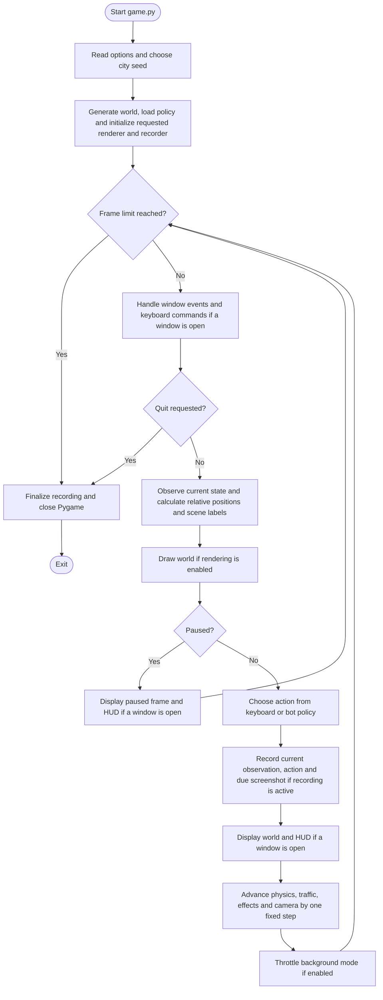
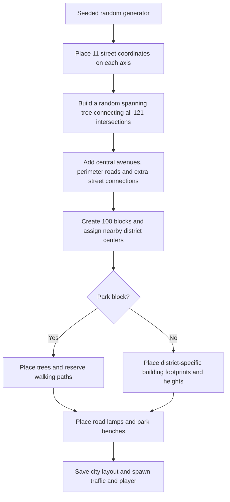

**Freeway Drift: flowcharts and code guide**

Freeway Drift is a Python driving game with a Pygame isometric renderer. The
player drives a Ferrari-inspired car through a generated city, or lets a basic
bot drive. The game can record synchronized world state, controls and screenshots
for later analysis or machine learning.

This guide describes the current Python implementation. The browser documentation
in the legacy section of the README describes a different implementation.

**Main game flow**

The following chart follows the order in [game.py](game.py). Nodes that mention
a window are skipped in headless mode. Rendering is optional in headless mode.



Interactive mode limits the loop to approximately 60 iterations per real second.
Each unpaused iteration advances simulation time by `1/60` second. If drawing or
recording is slow, the simulation falls behind real time; the loop does not run
extra catch-up steps. Pausing still allows events and drawing, but skips actions,
recording captures and physics. Ctrl+C and errors also pass through recording
cleanup in the `finally` block.

**Where each responsibility lives**

| File | Responsibility | Main entry points |
| --- | --- | --- |
| [game.py](game.py) | Options, keyboard input, pause, controller selection and main loop | `arguments`, `manual_action`, `run` |
| [city.py](city.py) | Generate streets, districts, buildings, trees and furniture | `generate_city`, `on_city_road`, `city_snapshot` |
| [simulation.py](simulation.py) | Own world state and advance vehicle physics, collisions, traffic and effects | `World`, `Action`, `World.step`, `World.observe` |
| [scene_labels.py](scene_labels.py) | Convert object coordinates to car-relative coordinates and label obstacle corridors | `corners`, `label_scene`, `overlap` |
| [renderer.py](renderer.py) | Project the world into an isometric image, draw objects and fade obstructing buildings | `Renderer.draw`, `Renderer.building`, `Renderer.obscures_car`, `Renderer.overlay` |
| [bot.py](bot.py) | Choose driving actions from observations | `Policy.act`, `BasicBot.act` |
| [recorder.py](recorder.py) | Stream observations/actions, input events, images and session metadata to disk | `DrivingRecorder.capture`, `event`, `close` |
| [benchmark.py](benchmark.py) | Measure observation, rendering and policy/physics time without a window | `main` |
| [test_python.py](test_python.py) | Check simulation, city generation, rendering and recording behavior | Python `unittest` test cases |

Simulation and city planning use the Python standard library. Pygame is needed
for the game window, rendering and PNG capture. State-only headless runs do not
import Pygame. The default policy is loaded at startup even for manual play, so
a custom `--policy` must be importable before switching to bot control.

**How a city is generated**



The outer street centers stay at `-1550` and `+1550` world units. Collision
boundaries stay at `-1584` and `+1584` on both axes. Selected central streets keep
their original coordinates so the bot's demonstration route remains usable.
Other street positions vary, and some side-street connections are absent.

Downtown has taller buildings, industrial blocks have large warehouses,
residential blocks have smaller homes, and commercial blocks have shops and open
lots. Parks interrupt those districts. Buildings stay clear of road rectangles.
Road grip, ground rendering and the minimap use the same generated rectangles.

Launching the CLI without `--seed` chooses a fresh random seed. With the current
generator, the same seed reproduces the same layout. `World()` in Python code
defaults to seed `8224`. R resets the player on the existing map; N replaces the
world and closes any active recording. The city generator version and seed are
included in observations.

**Controls and physics**

Keyboard input or `policy.act(observation)` produces one `Action`:

```python
Action(accelerate=True, brake_reverse=False, steering=0.0, handbrake=False)
```

Steering ranges from `-1` for left to `+1` for right. Acceleration,
braking/reversing and handbrake inputs are booleans. Steering input is smoothed
before it changes the car's heading. Longitudinal speed, lateral grip, drag,
terrain and the chosen vehicle model determine the resulting velocity.

`World.step` divides each default `1/60` second step into two smaller physics
substeps. Each substep attempts movement along X and Y, checks building footprints
and map boundaries, updates traffic, ages particles and skid marks, and moves the
camera toward the car with a velocity-based lookahead. Impacts bounce and slow
the car. Decorative trees and furniture do not block it.

Traffic follows the continuous central avenues, brakes for nearby cars and wraps
at the map edge. The built-in bot follows a four-waypoint central loop, steers
toward its next waypoint and slows for turns and nearby solid objects. It is a
demonstration policy with access to complete world state. Pixel-based inference
and general route planning would require extending that interface.

| Key | Action |
| --- | --- |
| WASD / arrows | Drive |
| Space | Handbrake |
| R | Reset the player and increment the segment |
| N | Generate a fresh city and close the current recording |
| Escape | Pause/resume; pausing closes the active recording |
| B | Switch manual/bot control |
| F9 | Start/stop recording while unpaused |
| T | Toggle traffic |
| G | Toggle obstacle corridor outlines |
| 1 / 2 / 3 | Select Ferrari / Weekender / Explorer |

Losing window focus clears held controls. Manual mode pauses and closes its
recording; bot mode keeps driving and recording unless already paused.

**Car-relative coordinates and scene labels**

`World.observe` builds a snapshot for the renderer, policy and recorder. The
snapshot contains every object, including off-screen objects and disabled
traffic. Recording exclusions can filter selected types from saved object rows.

The player's `car.relative_position` is always `{"x": 0.0, "y": 0.0}`.
Every object has its center expressed in the same car-relative frame:

| Field | Meaning |
| --- | --- |
| `relative_position.x` | Ahead of the car; negative means behind |
| `relative_position.y` | Right of the car; negative means left |
| `relative_center.forward/right` | The same position using forward/right names |
| `relative_heading` | Object heading minus car heading, wrapped to radians in the range -pi to pi |
| `relative_velocity.forward/right` | Object velocity minus car velocity, rotated into the car's axes |
| `x`, `y`, `a` | World center position and heading for rendering and reconstruction |

For car world position `(cx, cy)`, heading `a`, and object center `(ox, oy)`:

```text
dx = ox - cx
dy = oy - cy
relative_x =  dx * cos(a) + dy * sin(a)
relative_y = -dx * sin(a) + dy * cos(a)
```

For example, `relative_position = {"x": 100, "y": -20}` means 100 units ahead
and 20 units left. The coordinates change as the player moves or turns. These
units are the game's world units, not calibrated meters.

Scene labeling constructs left, center and right corridors in front of the car.
Each is 40 units wide; lookahead defaults to 140 units from the front bumper.
Active solid building and traffic footprints must overlap a corridor with
positive area to mark it blocked. Merely touching a boundary does not count.
Labels describe occupancy, including off-screen obstacles; they do not prescribe
a steering action or account for visual occlusion.

**Drawing and building transparency**

The renderer projects world X/Y and object height into screen coordinates, then
draws visible objects in increasing `x + y` order. It computes clipped image
bounding boxes without removing off-screen objects from observations.

For a foreground building drawn after the player, `obscures_car` tests rays from
the car's footprint corners and center at two heights toward the isometric
camera. If a ray intersects the building volume, the renderer draws that building
onto a reusable transparent layer and composites it at alpha `85/255`, about 33%
opacity. Walls, roof and windows fade together. The check runs every frame, so
the building returns to normal when it stops obscuring the car. This is a sampled
visibility check rather than a per-pixel visibility solver.

Roads and ground details use a cached viewport with a 128-pixel gutter. Camera
motion usually shifts that cached image; moving beyond the gutter or changing
cities rebuilds it. The renderer also caches HUD text, color shading and the
minimap background. These reduce repeated work while retaining the visual style.

**Recording and action alignment**

The loop observes and draws the world **before applying the next action**. It
records that observation, the selected action and a due screenshot together.
Only afterward does physics advance the world:

```text
observation N + action N -> simulation step -> observation N+1
```

This ordering makes a row a direct observation/action example. PNGs capture the
world surface before the display HUD, minimap and detection outlines are drawn.
Building transparency is part of the world surface and therefore appears in PNGs.

| Output | Contents |
| --- | --- |
| `frames.jsonl.gz` | One compressed JSON row per recorded simulation frame: state, relative positions, labels, action, controller, timing and optional image path |
| `inputs.jsonl` | Control transitions and lifecycle events such as reset, pause and controller changes |
| `frames/*.png` | Screenshots at the requested image cadence, fitted within 960 × 540 without upscaling |
| `session.json` | Schema 3 metadata, initial/final state, coordinate descriptions, capture counts and stop reason |

The default screenshot interval is 0.2 simulated seconds; `--image-interval 0`
captures every frame. Rows between screenshots still contain state and use
`image: null`. Recording closes at 120 simulated seconds by default. Use
`--max-record-seconds 0` for unlimited duration. Input timestamps use a monotonic
elapsed clock anchored to Unix time; simulation time is stored separately.

Resetting with R keeps the session open and increments `segment`. Changing
controllers produces an event. Avoid building training sequences across resets,
controller changes or sessions, and split training/validation by whole sessions.

**Run modes and checks**

From the `Freeway-Drift` directory, install `requirements.txt` and run:

```sh
python game.py
python game.py --seed 8224 --bot
python game.py --headless --bot --steps 600 --record
python game.py --headless --bot --steps 60 --render --record
python game.py --background
python benchmark.py --frames 600
python -m unittest -v test_python.py
```

On Windows, the same commands can use `py` in place of `python`.
`--headless` runs without a window and without the interactive frame cap;
`--render` adds off-screen rendering. Its default limit is 3600 simulation frames.
`--background` enables the bot without a window, targets real-time speed and
defaults to unlimited frames. Ctrl+C stops either mode and finalizes recordings.

The benchmark includes observation creation, world rendering and bot/physics
work, including cold caches. It excludes the display, HUD, recording and frame
cap, so its result is not the same as interactive or recording frame rate.

The test suite covers deterministic replay, relative coordinates, road
connectivity and building clearance, bot traversal, input/focus behavior,
building alpha blending, camera-cache rebuilding, recording limits and
synchronized screenshot capture. See [PYTHON.md](PYTHON.md) for the detailed
recording reference and custom ML policy example.
